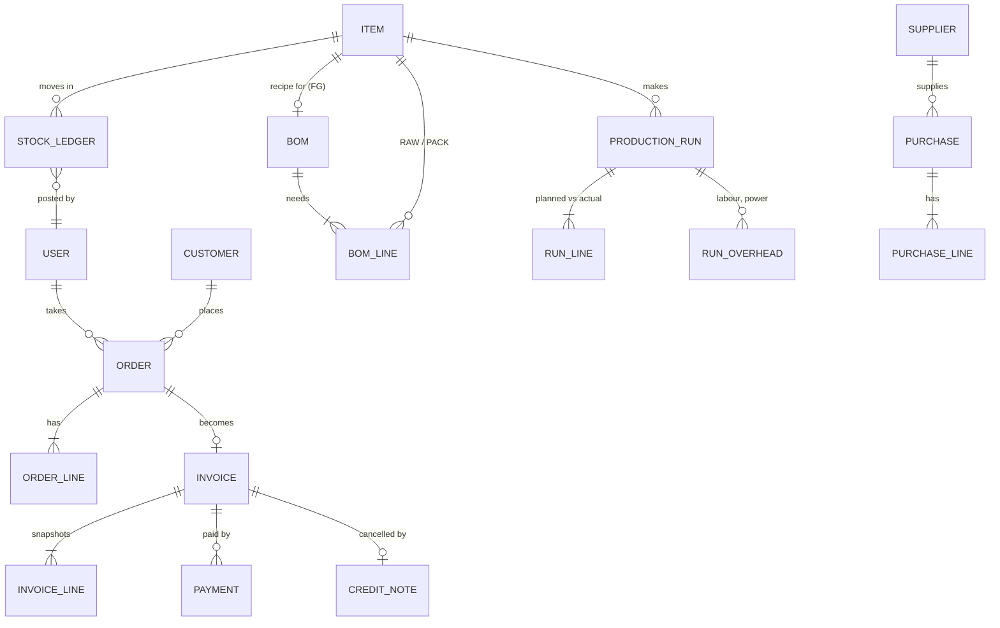

# Design note

## 1. Data model

`items` holds raw materials, packaging and finished goods (`kind` = RAW / PACK / FG), so one ledger and one set of
unit rules serve all three. `audit_log` records who changed what and when (not drawn above).

## 2. How stock is computed

* **One append-only table, `stock_ledger`.** Each row is a signed quantity and a signed value for one item, with
  `doc_type` + `doc_id` + `doc_ref` pointing at the source document (PURCHASE, RUN_ISSUE, RUN_PACK, RUN_OUTPUT,
  RUN_OVERHEAD, DISPATCH, RETURN, ADJUST, OPENING).
* **A balance is never stored.** `balance = SUM(qty_base)` for the item, so opening + receipts - issues ± adjustments
  = closing holds by construction; the stock summary report shows each term.
* **Nothing goes negative.** `stock.issue` checks the balance first and raises, so a failed dispatch or run posts
  nothing (the request's transaction rolls back).
* **Units.** Quantities are integers in base units: grams, millilitres, pieces. `kg`, `L`, `carton` etc. are
  conversions at the edge (`money.to_base`). A quantity finer than one base unit is rejected, not rounded.
* **Money** is integer paise. Every division uses `round_div` (half away from zero). No floats for money.

## 3. BOM consumption and variance

A BOM holds the standard quantity of each input per batch and the expected yield in packets.

1. **Start run.** Raw materials are issued (default = standard x batches; the supervisor types what was really
   issued). Each issue is a `RUN_ISSUE` ledger row and a `run_lines` row holding planned, actual and cost.
2. **Complete run.** The supervisor enters good packets, damaged pouches and (optionally) packaging used. Pouches
   default to good + damaged; cartons default to the standard scaled to good output. Packaging is issued
   (`RUN_PACK`) and finished goods received (`RUN_OUTPUT`) in the same transaction.
3. **Variance** = (actual - planned) / planned, two decimals, for every input and for yield. Absolute variance above
   `VARIANCE_TOLERANCE_PCT` (3%) is flagged on the run, the dashboard and the production report.

## 4. Valuation and costing

* **Method: weighted average.** On every issue the value removed is `balance_value x qty / balance_qty`, in integer
  paise. Chosen because purchase rates change (flour 42 then 45) and a small factory cannot say which kilo went into
  which batch. FIFO needs lot tracking; last-price misvalues opening stock.
  Benchmark flour: (100 kg x 42 + 60 kg x 45) / 160 kg = Rs 43.125/kg, so 40 kg costs Rs 1,725.
* **Overheads** (labour, gas, power) are entered against a run and absorbed in full by that run. If entered after
  completion, the finished-goods stock value rises by the same amount (a value-only ledger row).
* **Cost per packet** = (material + overhead) / good packets, so damaged and short output are paid for by the packets
  sold. Margin = selling price - cost per packet.
* **Cost of goods dispatched** is the weighted-average finished-goods cost at that moment.

## 5. Sales and tax

Order (SUBMITTED) -> admin edits/approves after a stock check (APPROVED) -> invoice (INVOICED) -> dispatch
(DISPATCHED). Available stock = balance minus quantities promised to other approved orders. GST per line:
`tax = round(taxable x rate)`; within Tamil Nadu CGST = floor(tax/2) and SGST = the remainder (an odd paisa is never
lost); otherwise IGST. Invoices snapshot rate, HSN and tax and are numbered `INV/<FY>/<seq>` (unique per FY).
Posted invoices are cancelled with a credit note `CN/<FY>/<seq>`, which returns dispatched stock through a RETURN
ledger row; invoices are never deleted.

## 6. First-expiry-first-out

Each production run stamps its batch number and expiry on the finished-goods ledger rows. Dispatch groups the item's
ledger by batch, orders batches by expiry (stock with no batch, i.e. opening stock, counts as oldest) and writes one
DISPATCH row per batch used. The total value removed is still the weighted-average value, split across the batches in
proportion to quantity with the remainder on the last row, so no paisa is lost. A credit note reverses each row into the
same batch.

## 7. Roles

salesman: own orders only. admin: orders, invoices, dispatch, payments, masters. production: purchases, runs, stock
adjustments. accountant and owner: read-only reports, invoices and stock; owner also gets the dashboard.
Every route carries a `web.require(...)` role dependency.
